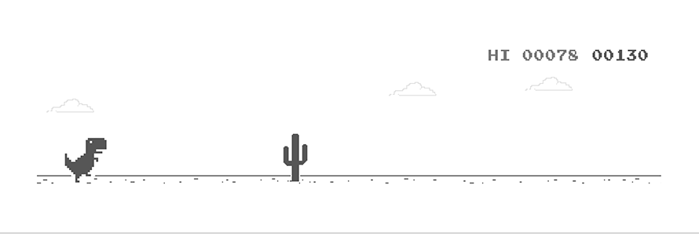

## Olá  eu sou o Matheus

<h2>sobre mim</h2>

- 💻 Desenvolvedor em formação, focado em mobile e front-end
- 🌱 Técnico em ADS na Etec Ermelinda Gianni Teixeira (Centro Paula Souza), em Santana de Parnaíba
- 🐾 Criando o PataLar, meu TCC: um app de adoção de pets
- 🔭 Aprendendo React Native

- <h4>Linguagens</h4>

- <h4>Frameworks & Plataformas</h4>

- <h4>Banco de Dados</h4>

- <h4>Ferramentas</h4>

 

  

